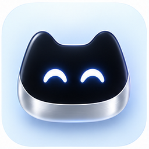

<p align="center">
  
</p>

<h1 align="center">Nexo Dedicated Appliance</h1>

<p align="center">
  Asisten suara ambient dengan wajah ekspresif, klien Android native, dan penalaran Hermes Agent.
  <br />
  <strong>Compatible with Hermes Agent CLI · Android Native · Python Gateway</strong>
  <br />
  <strong>Berkarya dengan hati @ 2026</strong>
  <br />
  Yanto Hariyono · YH Dev
</p>

Nexo (sebelumnya Jarvis) menghadirkan interaksi suara melalui tablet atau layar pintar berbasis Android: berbicara, melihat respons maskot, dan mendengarkan jawaban tanpa mengetik. Tidak perlu PC konvensional di meja; komputasi penalaran dan pemrosesan suara tetap berjalan pada server terpisah. Monitor biasa memerlukan perangkat komputasi pendamping.

## Tampilan aplikasi

<table>
  <tr>
    <td align="center"><strong>Mikrofon ON</strong></td>
    <td align="center"><strong>Mikrofon OFF</strong></td>
  </tr>
  <tr>
    <td align="center"></td>
    <td align="center"></td>
  </tr>
  <tr>
    <td align="center">Status menyimak, respons teks, dan salin jawaban.</td>
    <td align="center">Kontrol Mulai mikrofon, ekspresi menangis, tanpa panel bawah.</td>
  </tr>
</table>

Screenshot dikirim oleh pengembang; ilustrasi UI ini bukan bukti setiap revisi source telah diuji pada perangkat.

## Pengalaman utama

- **Native Kotlin, bukan WebView.** Tampilan portrait berlatar hitam dengan maskot, kedipan, gerakan tatapan, dan transisi ekspresi.
- **Kontrol mikrofon yang eksplisit.** Mulai/Berhenti mengendalikan audio dan koneksi melalui service. Instalasi baru dimulai dalam keadaan OFF; indikator kesiapan tetap terpisah dari animasi wajah.
- **16 ekspresi maskot.** Reaksi ON/OFF, ekspresi percakapan berbasis aturan konteks, dan perintah singkat untuk mengubah wajah.
- **Antarmuka yang tenang.** Ucapan senang saat ON hilang setelah 15 detik. Panel COGNITIVE STREAM tersembunyi ketika OFF agar wajah mendapat lebih banyak ruang.
- **Jawaban dapat disalin.** Ikon clipboard di kanan header menyalin jawaban final asisten secara lengkap, bukan hanya baris yang terlihat.
- **Konfigurasi perangkat.** Bottom sheet native untuk kredensial, endpoint WSS dari Firebase Remote Config, dan autentikasi per perangkat.
- **Terminal & Local Session Bridge.** Utilitas CLI `scripts/nexo` untuk interaksi kognitif langsung dari terminal developer.

## Beri Nexo ekspresi

Saat mikrofon ON dan siap, ucapkan perintah pendek yang berdiri sendiri:

| Perintah | Reaksi |
| --- | --- |
| “Nexo, tersenyum” (atau “Jarvis, tersenyum”) | Senang |
| “Coba tertawa” | Tertawa |
| “Tunjukkan wajah bingung” | Bingung |
| “Berkedip” | Mengedip |
| “Ekspresi jahil” | Jahil |
| “Jangan sedih” | Kembali senang |
| “Kembali normal” | Netral |

Perintah wajah yang dikenali ditangani langsung oleh gateway tanpa panggilan penalaran Hermes. Pertanyaan dan instruksi campuran tetap diteruskan ke agen. Ekspresi juga dapat mengikuti frasa konteks seperti sapaan, humor, keberhasilan, atau cerita sedih; pemilihannya berbasis aturan terbatas, bukan pembacaan emosi manusia.

Reaksi percakapan bertahan singkat setelah pemutaran selesai, kemudian kembali ke ekspresi dasar. Perintah tidak dapat menyalakan mikrofon yang OFF dan tidak mengunci suasana hati secara permanen. Lihat [panduan ekspresi](docs/MASCOT_EXPRESSIONS.md) untuk cakupan dan batasannya.

## Arsitektur

```text
Perangkat Android                          Server
┌──────────────────────────┐               ┌──────────────────────────────┐
│ Mikrofon + speaker       │   WSS + auth  │ FastAPI audio gateway        │
│ Native Kotlin            │ ◄───────────► │ VAD → Faster-Whisper (STT)    │
│ Maskot + kontrol privasi │   PCM / JSON  │ Perintah wajah / Hermes Agent│
│ Pemutaran respons        │               │ Edge TTS → PCM respons       │
└──────────────────────────┘               └──────────────────────────────┘
```

Transport WebSocket dua arah membawa audio dan pesan kontrol. Percakapan saat ini memakai alur **half-duplex**: pengiriman audio mikrofon dijeda selama pemrosesan/pemutaran agar respons speaker tidak ditangkap sebagai perintah baru. Ini bukan klaim barge-in atau percakapan simultan full-duplex.

Hermes memakai sesi lokal bernama `nexo` (atau `appliance`), bukan otomatis sesi Telegram. Detail sesi dan pemilihan model ada di [APPLIANCE_SESSION](docs/APPLIANCE_SESSION.md).

## Compatible dengan Hermes Agent

Nexo memakai **Hermes Agent CLI** sebagai mesin penalaran pada server. Ini integrasi independen, bukan produk resmi atau endorsement Nous Research. Bridge menjalankan:

```bash
hermes chat -c nexo --create-if-missing -q "<transkripsi pengguna>" -Q
```

Runtime Hermes harus mendukung flag tersebut. Provider/model, tools, dan kredensial mengikuti akun/profil Hermes yang dipakai layanan; tidak ditanamkan ke APK. Sesi `nexo` tidak otomatis mengikuti Telegram. Perintah ekspresi pendek yang dikenali ditangani gateway, sedangkan permintaan biasa diteruskan ke Hermes. Catatan kompatibilitas CLI dan batas verifikasi ada di [panduan instalasi lengkap](docs/INSTALLATION.md).

Sebelum memasang gateway, instal dan konfigurasi Hermes pada akun layanan:

```bash
# Installer resmi CLI untuk Linux/macOS/WSL2; tinjau sebelum menjalankan.
curl -fsSL https://hermes-agent.nousresearch.com/install.sh | bash
hermes setup
hermes model
hermes doctor
hermes --version
```

Lihat [dokumentasi resmi Hermes](https://hermes-agent.nousresearch.com/docs/getting-started/installation). Token perangkat Nexo bukan sandbox untuk tools Hermes; gunakan akun layanan berhak minimum dan perangkat tepercaya.

## Memulai

Panduan teknis lengkap, systemd, provisioning, penggunaan sehari-hari dan troubleshooting: **[INSTALLATION](docs/INSTALLATION.md)**.

### Server

Prasyarat: Python 3.11+, runtime Hermes Agent, dan konfigurasi layanan suara. Dari root repository:

```bash
git clone https://github.com/mrthx89/Jarvis.git
cd Jarvis
python3 -m venv server/.venv
source server/.venv/bin/activate
pip install -r server/requirements.txt
cp server/config.example.yaml server/config.yaml
```

Sebelum membuka akses perangkat, ikuti [provisioning dan autentikasi](docs/DEVICE_AUTH.md), lalu isi konfigurasi server. Registry kosong menolak koneksi perangkat. Jangan menaruh token di README, Git, atau Firebase Remote Config.

Jalankan dari direktori `server/` agar konfigurasi lokal dimuat:

```bash
cd server
PYTHONPATH=src .venv/bin/python -m nexo_server.main
```

Health endpoint: `http://127.0.0.1:8765/health`. Koneksi klien: `wss://<domain-anda>/ws/appliance` (default `wss://nexo.yhdev.my.id/ws/appliance`) melalui terminasi TLS yang sesuai. Status health bukan bukti keberhasilan percakapan suara end-to-end.

### Android

1. Buka `android/` di Android Studio dengan full JDK 17 dan Android SDK 34.
2. Sediakan konfigurasi Firebase lokal untuk paket `id.my.yhdev.nexo` (atau `id.my.yhdev.jarvis`) dan atur endpoint WSS sesuai [panduan Remote Config](docs/REMOTE_CONFIG_SETUP.md).
3. Ikuti [panduan build dan signing](docs/BUILDING.md). Build dilakukan pada komputer pengembang; tidak perlu membuild Android di server gateway.
4. Jalankan aplikasi, izinkan mikrofon, lalu tekan lama status untuk membuka pengaturan kredensial perangkat.
5. Tekan **Mulai mikrofon** dan tunggu status kesiapan sebelum berbicara. Tekan **Berhenti** untuk menghentikan audio/koneksi. Ketuk status untuk melihat detail gangguan.

## Struktur repository

```text
android/     Klien Kotlin, audio, service, maskot, dan resource UI
resource/    Artwork dan sumber maskot
server/      Gateway FastAPI, STT/TTS, autentikasi, dan jembatan Hermes
skills/      Paket Skill Hermes resmi (skills/nexo/SKILL.md) untuk otomasi agen
docs/        Panduan perangkat, protokol, keamanan, dan verifikasi
scripts/     Alat probe suara, CLI nexo, dan reproduksi aset maskot
artifact/sreenshoot/  Screenshot UI yang dikirim pengembang
```

## Dokumentasi

- [Skill Hermes Resmi Nexo](skills/nexo/SKILL.md) · [Panduan Sesi Terminal](docs/TERMINAL_SESSION_BRIDGE.md)
- [Instalasi teknis dan pemakaian](docs/INSTALLATION.md)
- [Versioning, kompatibilitas dan checklist rilis](docs/VERSIONING.md) · [Changelog](CHANGELOG.md)

- [Build Android dan signing](docs/BUILDING.md)
- [Autentikasi perangkat](docs/DEVICE_AUTH.md) · [Model keamanan](docs/SECURITY_MODEL.md)
- [Ekspresi dan perintah maskot](docs/MASCOT_EXPRESSIONS.md) · [Sumber artwork](docs/MASCOT_ASSETS.md)
- [Perilaku UI dan pemeriksaan perangkat](docs/MOBILE_UI_VERIFICATION.md)
- [Sesi dan model Hermes](docs/APPLIANCE_SESSION.md)
- [Arsitektur](docs/ARCHITECTURE.md) · [Protokol WebSocket](docs/PROTOCOL.md)
- [Hardware dan kiosk](docs/HARDWARE_SETUP.md) · [Firebase Remote Config](docs/REMOTE_CONFIG_SETUP.md)

## Verifikasi dan cakupan

Tes Python mencakup parser perintah, pemilihan ekspresi, alur gateway, dan keamanan; pemeriksaan source Android/XML menjaga invariant UI tanpa mengompilasi Kotlin. Instruksi tes dari root:

```bash
PYTHONPATH=server/src server/.venv/bin/python -m pytest server/tests -q
```

Kompilasi Android, tampilan layar, kualitas AEC, izin mikrofon, serta percakapan nyata harus diverifikasi pada perangkat target. Tidak ada jaminan 60 FPS, latensi tertentu, atau barge-in tanpa pengukuran. Perubahan source tidak memperbarui APK terpasang ataupun proses server yang masih berjalan; keduanya memerlukan deployment tersendiri. CI disediakan sebagai workflow manual, bukan build otomatis setiap push.

## Versioning

Metadata source saat ini: **Android 1.0.0 (versionCode 1)**, **server 0.1.0**, dan **protokol 1.0**. Komponen memiliki versi terpisah. Nilai source tidak membuktikan versi APK terpasang atau backend aktif. Perubahan yang belum dirilis dicatat sebagai **Unreleased**, bukan dianggap otomatis rilis produksi.

Gunakan Semantic Versioning, kenaikan versionCode setiap distribusi APK, tag komponen, checksum artifact dan catatan migrasi sesuai [VERSIONING](docs/VERSIONING.md). Lihat [CHANGELOG](CHANGELOG.md) sebelum upgrade. Finalisasi tampilan tidak menghapus kebutuhan build dan uji perangkat.

## Dukung pengembangan Jarvis

Jarvis dikembangkan dengan hati agar menjadi asisten yang berguna dan terus membaik. Jika proyek ini membantu, dukungan Anda membantu menyediakan waktu pengembangan, pengujian perangkat, dan pemeliharaan.

<a href="https://yapp.ink/jarvisyhdev"></a>

[Buy me a coffee](https://yapp.ink/jarvisyhdev) · [Laporkan masalah atau usulkan fitur](https://github.com/mrthx89/Jarvis/issues)

Dukungan bersifat sukarela. Anda juga dapat membantu melalui laporan bug yang jelas, pengujian, dokumentasi dan kontribusi kode—tanpa membagikan token, keystore, atau data percakapan privat.

## Lisensi

Dikembangkan oleh **Yanto Hariyono (YH Dev)** dengan semangat **berkarya dengan hati @ 2026**. Kode proyek menggunakan [lisensi MIT](LICENSE).
